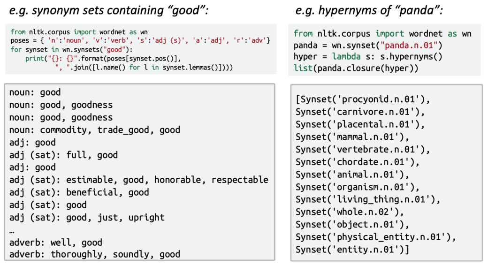
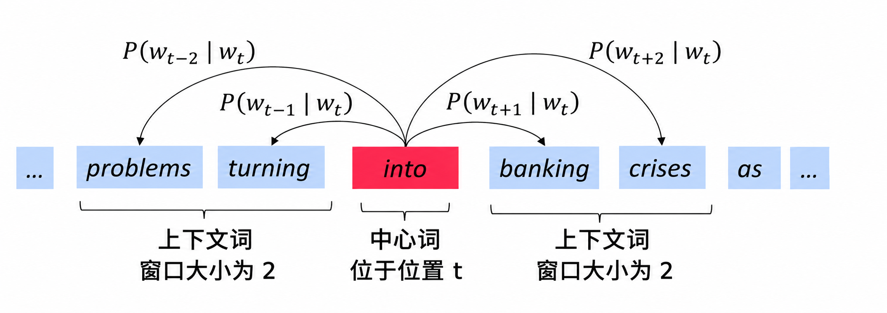
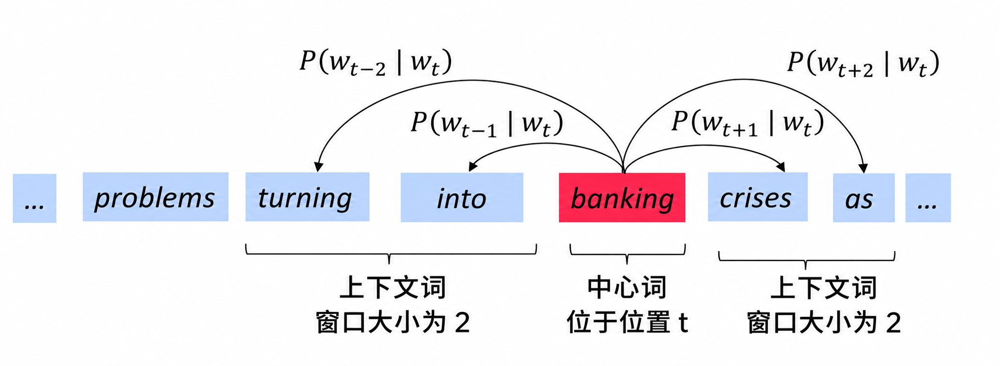
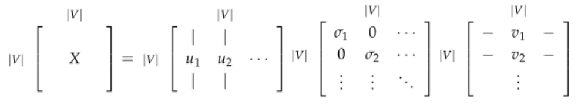
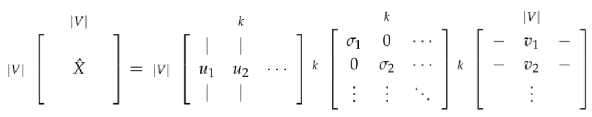
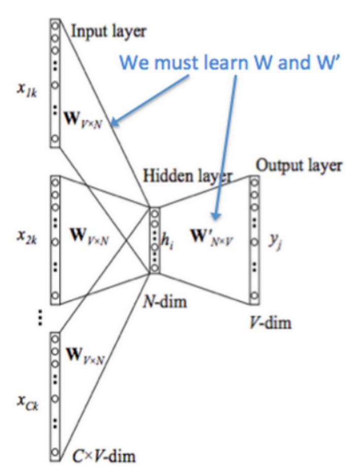
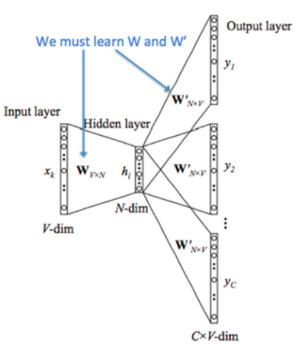
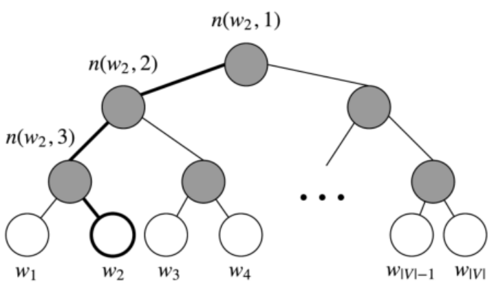

# Lecture 01 Introduction and Word Vectors


## Lecture Plan

- The course
- Human language and word meaning
- Word2vec introduction
- Word2vec objective function gradients
- Optimization basics
- Looking at word vectors

## Human language and word meaning

人类之所以比类人猿更“聪明”，是因为我们有语言，因此是一个人机网络，其中人类语言作为网络语言。人类语言具有**信息功能**和**社会功能**。

据估计，人类语言只有大约 5000 年的短暂历史。语言是人类变得强大的主要原因。写作是另一件让人类变得强大的事情。它是使知识能够在空间上传送到世界各地，并在时间上传送的一种工具。

但是，相较于如今的互联网的传播速度而言，人类语言是一种缓慢的语言。然而，只需人类语言形式的几百位信息，就可以构建整个视觉场景。这就是自然语言如此迷人的原因。

### How do we represent the meaning of a word?

**meaning**

- 用一个词、词组等表示的概念。
- 一个人想用语言、符号等来表达的想法。
- 表达在作品、艺术等方面的思想。

理解意义的最普遍的语言方式（**linguistic way**）：语言符号与语言符号的意义的转化。

$$
\begin{aligned}
\boxed{\text{signifier (symbol)} \Leftrightarrow \text{signified (idea or thing)}}\\
=\text{denotational semantics}
\end{aligned}
\tag{43}
$$

> denotational semantics：指称语义。

### How do we have usable meaning in a computer?

**WordNet**，一个包含同义词集和上位词（“is a”关系）**synonym sets and hypernyms** 的列表的辞典。



### Problems with resources like WordNet

- 作为一个资源很好，但忽略了细微差别。
  - 例如“proficient”被列为“good”的同义词。这只在某些上下文中是正确的。
- 缺少单词的新含义。
  - 难以持续更新。
  - 例如 wicked, badass, nifty, wizard, genius, ninja, bombest。
- 主观的。
- 需要人类劳动来创造和调整。
- 无法计算单词相似度。

### 将词语表示为离散符号

在传统的自然语言处理中，我们把词语看作离散的符号：hotel, conference, motel——a **localist** representation。

单词可以通过独热向量（one-hot vectors，只有一个 1，其余均为 0 的稀疏向量）表示。向量维度 = 词汇量（如 500,000）。

$$
\begin{aligned}
\text{motel}&=[0\ 0\ 0\ 0\ 0\ 0\ 0\ 0\ 1\ 0\ 0\ 0\ 0\ 0\ 0]\\
\text{hotel}&=[0\ 0\ 0\ 0\ 0\ 0\ 0\ 1\ 0\ 0\ 0\ 0\ 0\ 0\ 0]
\end{aligned}
\tag{44}
$$

### **将词语表示为离散符号存在的问题**

所有向量是正交的。对于独热向量，没有关于相似性概念，并且向量维度过大。

### **解决方法**

- 使用类似 WordNet 的工具中的列表，获得相似度，但会因不够完整而失败。
- 学习在向量本身中编码相似性。

### 通过上下文来表示词语

- **Distributional semantics**：一个单词的意思是由经常出现在它附近的单词给出的。
  - “You shall know a word by the company it keeps” (J. R. Firth 1957: 11)
  - 现代统计 NLP 最成功的理念之一。
  - 有点物以类聚，人以群分的感觉。
- 当一个单词 $w$ 出现在文本中时，它的上下文是出现在其附近的一组单词（在一个固定大小的窗口中）。
- 使用 $w$ 的许多上下文来构建 $w$ 的表示。


## Word2vec introduction

我们为每个单词构建一个**密集**的向量，使其与出现在相似上下文中的单词向量相似。

词向量 **word vectors** 有时被称为词嵌入 **word embeddings** 或词表示 **word representations**。

它们是分布式表示 **distributed representation**。

$$
\text{banking}=\begin{bmatrix}
0.286\\0.792\\-0.177\\-0.107\\0.109\\-0.542\\0.349\\0.271
\end{bmatrix}
$$

**Word2vec** (Mikolov et al. 2013) 是一个学习单词向量的**框架**。

**IDEA：**

- 我们有大量的文本（corpus means 'body' in Latin，复数为 corpora）。
- 固定词汇表中的每个单词都由一个向量表示。
- 文本中的每个位置 $t$，其中有一个中心词 $c$ 和上下文（“外部”）单词 $o$。
- 使用 $c$ 和 $o$ 的**词向量的相似性**来计算给定 $c$ 的 $o$ 的**概率**（反之亦然）。
- **不断调整词向量**来最大化这个概率。

下图为窗口大小 $j=2$ 时的 $P(w_{t+j}\mid w_t)$ 计算过程，center word 分别为 $into$ 和 $banking$。

例如：
$$
P(w_{t+1}|w_{t})=P(banking|into)
$$
读作：已知中心词是 into，周围出现 banking 的概率。





## Word2vec objective function

对于每个位置 $t=1,\ldots,T$，在大小为 $m$ 的固定窗口内预测上下文单词，给定中心词 $w_t$。

$$
\text{Likelihood}=L(\theta)=\prod_{t=1}^{T}\prod_{\substack{-m\leq j\leq m\\j\neq0}}P(w_{t+j}\mid w_t;\theta)
\tag{45}
$$

- 其中，$\theta$ 为所有需要优化的变量。

目标函数 $J(\theta)$（有时被称为代价函数或损失函数）是（平均）负对数似然。

$$
J(\theta)=-\frac{1}{T}\log L(\theta)
=-\frac{1}{T}\sum_{t=1}^{T}\sum_{\substack{-m\leq j\leq m\\j\neq0}}\log P(w_{t+j}\mid w_t;\theta)
\tag{46}
$$

其中 log 形式是方便将连乘转化为求和，负号是希望将极大化似然率转化为极小化损失函数的等价问题。

> 在连乘之前使用 log 转化为求和非常有效，特别是在做优化时。

$$
\log\prod_i x_i=\sum_i\log x_i
\tag{47}
$$

- 最小化目标函数 $\Leftrightarrow$ 最大化预测精度。
- **问题**：如何计算 $P(w_{t+j}\mid w_t;\theta)$？
- 回答：对于每个单词都是用两个向量。每个词有两种角色。
  - $v_w$：当 $w$ 是中心词时使用。
  - $u_w$：当 $w$ 是上下文词时使用。
- 于是对于一个中心词 $c$ 和一个上下文词 $o$：

$$
P(o\mid c)=\frac{\exp(u_o^T v_c)}{\sum_{w\in V}\exp(u_w^T v_c)}
\tag{48}
$$
> 1. 为什么每个词有2个向量
> 
> 比如预测`banking → crises`时用的是$v_{banking}$和$u_{crises}$。
> 
> 预测`crises → banking`时用的是$v_{crises}$和$u_{banking}$。
> 
> 这两套向量都是训练学出来的，通常不相同。
> 2. 先用点积给每个候选词打分
> 对于中心词 $c$ 和候选上下文词 $o$，分数是：
> $$s_{o}=u^{T}_{o}v_{c}$$
> 假设
> $$
v_{\text{banking}}=
\begin{bmatrix}1\\0\end{bmatrix},
\qquad
u_{\text{crises}}=
\begin{bmatrix}2\\1\end{bmatrix}
$$
> 那么$$s_{\text{crises}}=2\times1+1\times0=2$$
> 点积越大，模型就越倾向于把这个词预测为上下文词。 但分数可能是负数，也不一定在 0 到 1 之间，所以还不能直接当概率。
> 3. 用 Softmax 把分数变成概率
> 假设词表只有三个词，给定中心词 banking，模型计算出的分数如下：
> 
> | 候选上下文词 | 点积分数 | 取指数后 | 最终概率 |
> | --- | --- | --- | --- |
> | crises | 2 | 7.39 | 66.5% |
> | money | 1 | 2.72 | 24.5% |
> | banana | 0 | 1 | 9.0% |
> 
> 例如：
> $$P(\text{crises}\mid\text{banking})
=\frac{e^2}{e^2+e^1+e^0}
\approx66.5\%$$
> 
## Word2vec prediction function

$$
P(o\mid c)=\frac{\exp(u_o^T v_c)}{\sum_{w\in V}\exp(u_w^T v_c)}
\tag{49}
$$

- 取幂使任何数都为正。
- 点积比较 $o$ 和 $c$ 的相似性：$u^T v=u\cdot v=\sum_{i=1}^{n}u_i v_i$，点积越大则概率越大。
- 分母：对整个词汇表进行标准化，从而给出概率分布。

**softmax function** $\mathbb{R}^n\rightarrow\mathbb{R}^n$：

$$
\operatorname{softmax}(x_i)=\frac{\exp(x_i)}{\sum_{j=1}^{n}\exp(x_j)}=p_i
\tag{50}
$$

将任意值 $x_i$ 映射到概率分布 $p_i$。

- **max**：因为放大了最大的概率。
- **soft**：因为仍然为较小的 $x_i$ 赋予了一定概率。
- 深度学习中常用。

首先我们随机初始化 $u_w\in\mathbb{R}^d$ 和 $v_w\in\mathbb{R}^d$，而后使用梯度下降法进行更新。

$$
\frac{\partial}{\partial v_c}\log P(o\mid c)
=\frac{\partial}{\partial v_c}\log\frac{\exp(u_o^T v_c)}{\sum_{w\in V}\exp(u_w^T v_c)}
\tag{51}
$$

$$
=\frac{\partial}{\partial v_c}\left(\log\exp(u_o^T v_c)-\log\sum_{w\in V}\exp(u_w^T v_c)\right)
\tag{52}
$$

$$
=\frac{\partial}{\partial v_c}\left(u_o^T v_c-\log\sum_{w\in V}\exp(u_w^T v_c)\right)
\tag{53}
$$

$$
=u_o-\frac{\sum_{w\in V}\exp(u_w^T v_c)u_w}{\sum_{w\in V}\exp(u_w^T v_c)}
\tag{54}
$$

> 偏导数可以移进求和中，对应上方公式的最后两行的推导。

$$
\frac{\partial}{\partial x}\sum_i y_i=\sum_i\frac{\partial}{\partial x}y_i
\tag{55}
$$

我们可以对上述结果重新排列如下，第一项是真正的上下文单词，第二项是预测的上下文单词。使用梯度下降法，模型的预测上下文将逐步接近真正的上下文。

$$
\frac{\partial}{\partial v_c}\log P(o\mid c)
=u_o-\frac{\sum_{w\in V}\exp(u_w^T v_c)u_w}{\sum_{w\in V}\exp(u_w^T v_c)}
\tag{56}
$$

$$
=u_o-\sum_{w\in V}\frac{\exp(u_w^T v_c)}{\sum_{w'\in V}\exp(u_{w'}^T v_c)}u_w
\tag{57}
$$

$$
=u_o-\sum_{w\in V}P(w\mid c)u_w
\tag{58}
$$

再对 $u_o$ 进行偏微分计算，注意这里的 $u_o$ 是 $u_{w=o}$ 的简写，故可知：

$$
\frac{\partial}{\partial u_o}\sum_{w\in V}u_w^T v_c
=\frac{\partial}{\partial u_o}u_o^T v_c
=\frac{\partial u_o}{\partial u_o}v_c+\frac{\partial v_c}{\partial u_o}u_o=v_c
$$

$$
\frac{\partial}{\partial u_o}\log P(o\mid c)
=\frac{\partial}{\partial u_o}\log\frac{\exp(u_o^T v_c)}{\sum_{w\in V}\exp(u_w^T v_c)}
\tag{59}
$$

$$
=\frac{\partial}{\partial u_o}\left(\log\exp(u_o^T v_c)-\log\sum_{w\in V}\exp(u_w^T v_c)\right)
\tag{60}
$$

$$
=\frac{\partial}{\partial u_o}\left(u_o^T v_c-\log\sum_{w\in V}\exp(u_w^T v_c)\right)
\tag{61}
$$

$$
=v_c-\frac{\sum_{w\in V}\frac{\partial}{\partial u_o}\exp(u_w^T v_c)}{\sum_{w\in V}\exp(u_w^T v_c)}
\tag{62}
$$

$$
=v_c-\frac{\exp(u_o^T v_c)v_c}{\sum_{w\in V}\exp(u_w^T v_c)}
\tag{63}
$$

$$
=v_c-\frac{\exp(u_o^T v_c)}{\sum_{w\in V}\exp(u_w^T v_c)}v_c
\tag{64}
$$

$$
=v_c-P(o\mid c)v_c
\tag{65}
$$

$$
=(1-P(o\mid c))v_c
\tag{66}
$$

可以理解，当 $P(o\mid c)\rightarrow1$，即通过中心词 $c$ 我们可以正确预测上下文词 $o$，此时我们不需要调整 $u_o$，反之，则相应调整 $u_o$。

关于此处的微积分知识，可以通过[《神经网络与深度学习》](https://nndl.github.io/)中的**附录 B**了解。

# Notes 01 Introduction, SVD and Word2Vec

**Keyphrases**: Natural Language Processing. Word Vectors. Singular Value Decomposition. Skip-gram. Continuous Bag of Words (CBOW). Negative Sampling. Hierarchical Softmax. Word2Vec.

**概述**：这组笔记首先介绍了自然语言处理（NLP）的概念及其面临的问题。然后我们继续讨论将单词表示为数字向量的概念。最后，讨论了常用的词向量设计方法。

## Introduction to Natural Language Processing

### What is so special about NLP?

Natural language is a discrete/symbolic/categorical system.

> 离散的／符号的／分类的。

人类的语言有什么特别之处？人类语言是一个专门用来表达意义的系统，而不是由任何形式的物理表现产生的。在这方面上，它与视觉或任何其他机器学习任务都有很大的不同。

大多数单词只是一个语言学以外的符号：单词是一个映射到所指（signified，想法或事物）的能指（signifier）。

例如，“rocket”一词指的是火箭的概念，因此可以引申为火箭的实例。当我们使用单词和字母来表达符号时，也会有一些例外，例如“whoompaa”的使用。最重要的是，这些语言的符号可以被**编码成几种形式**：声音、手势、文字等等，然后通过连续的信号传输给大脑，大脑本身似乎也能以一种连续的方式对这些信号进行解码。人们在语言哲学和语言学方面做了大量的工作来概念化人类语言，并将词语与其参照、意义等区分开来。

### Examples of tasks

自然语言处理有不同层次的任务，从语言处理到语义解释再到语篇处理。自然语言处理的目标是通过设计算法使得计算机能够“理解”语言，从而能够执行某些特定的任务。不同的任务的难度是不一样的。

**Easy**

- 拼写检查 Spell Checking
- 关键词检索 Keyword Search
- 同义词查找 Finding Synonyms

**Medium**

- 解析来自网站、文档等的信息

**Hard**

- 机器翻译 Machine Translation
- 语义分析 Semantic Analysis
- 指代消解 Coreference
- 问答系统 Question Answering

### How to represent words?

在所有的 NLP 任务中，第一个也是可以说是最重要的共同点是我们如何将单词表示为任何模型的输入。在这里我们不会讨论早期的自然语言处理工作是将单词视为原子符号 atomic symbols。为了让大多数的自然语言处理任务能有更好的表现，我们首先需要了解单词之间的相似和不同。有了词向量，我们可以很容易地将其编码到向量本身中。

## Word Vectors

使用词向量编码单词，N 维空间足够我们编码语言的所有语义，每一维度都会编码一些我们使用语言传递的信息。简单的 one-hot 向量无法给出单词间的相似性，我们需要将维度 $|V|$ 减少至一个低维度的子空间，来获得稠密的词向量，获得词之间的关系。

## SVD Based Methods

这是一类找到词嵌入的方法（即词向量），我们首先遍历一个很大的数据集和统计词的共现计数矩阵 $X$，然后对矩阵 $X$ 进行 SVD 分解得到 $USV^T$。然后我们使用 $U$ 的行来作为字典中所有词的词向量。我们来讨论一下矩阵 $X$ 的几种选择。

### Word-Document Matrix

我们最初的尝试，我们猜想相关连的单词在同一个文档中会经常出现。例如，“banks”“bonds”“stocks”“moneys”等等，出现在一起的概率会比较高。但是“banks”“octopus”“banana”“hockey”不大可能会连续地出现。我们根据这个情况来建立一个 **Word-Document** 矩阵，$X$ 是按照以下方式构建：遍历数亿的文档和当词 $i$ 出现在文档 $j$，我们对 $X_{ij}$ 加一。这显然是一个很大的矩阵 $\mathbb{R}^{|V|\times M}$，它的规模是和文档数量 $M$ 成正比关系。因此我们可以尝试更好的方法。

### Window based Co-occurrence Matrix

同样的逻辑也适用于这里，但是矩阵 $X$ 存储单词的共现，从而成为一个关联矩阵。在此方法中，我们计算每个单词在特定大小的窗口中出现的次数。我们按照这个方法对语料库中的所有单词进行统计。

- 生成维度为 $|V|\times|V|$ 的共现矩阵 $X$。
- 在 $X$ 上应用 SVD 从而得到 $X=USV^T$。
- 选择 $U$ 前 $k$ 行得到 $k$ 维的词向量。[^svd-columns]
- $\frac{\sum_{i=1}^{k}\sigma_i}{\sum_{i=1}^{|V|}\sigma_i}$ 表示第一个 $k$ 维捕获的方差量。[^variance]

### Applying SVD to the cooccurrence matrix

我们对矩阵 $X$ 使用 SVD，观察奇异值（矩阵 $S$ 上对角线上元素），根据期望的捕获方差百分比截断，留下前 $k$ 个元素。

然后取子矩阵 $U_{1:|V|,1:k}$ 作为词嵌入矩阵。这就给出了词汇表中每个词的 $k$ 维表示。

对矩阵 $X$ 使用 SVD：

$$
X=USV^T
=\begin{bmatrix}|&|&&|\\u_1&u_2&\cdots&u_{|V|}\\|&|&&|\end{bmatrix}
\begin{bmatrix}\sigma_1&0&\cdots\\0&\sigma_2&\cdots\\\vdots&\vdots&\ddots\end{bmatrix}
\begin{bmatrix}-&v_1^T&-\\-&v_2^T&-\\&\vdots&\end{bmatrix}
$$



通过选择前 $k$ 个奇异向量来降低维度：

$$
\widehat X=U_{:,1:k}S_{1:k,1:k}V_{:,1:k}^T
=\sum_{i=1}^{k}\sigma_i u_i v_i^T
$$



这两种方法都给我们提供了足够的词向量来编码语义和句法（part of speech）信息，但伴随许多其他问题：

- 矩阵的维度会经常发生改变（经常增加新的单词和语料库的大小会改变）。
- 矩阵会非常的稀疏，因为很多词不会共现。
- 矩阵维度一般会非常高：$10^6\times10^6$。
- 基于 SVD 的方法的计算复杂度很高（$m\times n$ 矩阵的计算成本是 $O(mn^2)$），并且很难合并新单词或文档。
- 需要在 $X$ 上加入一些技巧处理来解决词频的急剧的不平衡。

然而，基于计数的方法可以有效地利用统计量。

对上述讨论中存在的问题存在以下的解决方法：

- 忽略功能词，例如“the”“he”“has”等等。
- 使用 ramp window，即根据文档中单词之间的距离对共现计数进行加权。
- 使用皮尔逊相关系数并将负计数设置为 0，而不是只使用原始计数。

正如我们在下一节中看到的，基于迭代的方法以一种优雅得多的方式解决了大部分上述问题。

## Iteration Based Methods - Word2vec

这里我们尝试一个新的方法。我们可以尝试创建一个模型，该模型能够一次学习一个迭代，并最终能够对给定上下文的单词的概率进行编码，而不是计算和存储一些大型数据集（可能是数十亿个句子）的全局信息。

这个想法是设计一个模型，该模型的参数就是词向量。然后根据一个目标函数训练模型，在每次模型的迭代计算误差，并遵循一些更新规则，该规则具有惩罚造成错误的模型参数的作用，从而可以学习到词向量。这个方法可以追溯到 1986 年，我们称这个方法为“反向传播”，模型和任务越简单，训练它的速度就越快。

- 基于迭代的方法一次捕获一个单词的共现情况，而不是像 SVD 方法那样直接捕获所有的共现计数。

已经很多人按照这个思路测试了不同的方法。[Collobert et al., 2011] 设计的模型首先将每个单词转换为向量。对每个特定的任务（命名实体识别、词性标注等等），他们不仅训练模型的参数，同时也训练单词向量，计算出了非常好的词向量的同时取得了很好的性能。

在这里，我们介绍一个非常有效的概率模型：Word2vec。Word2vec 是一个软件包实际上包含：

- **两个算法**：continuous bag-of-words（CBOW）和 skip-gram。CBOW 是根据中心词周围的上下文单词来预测该词的词向量。[^cbow-target] skip-gram 则相反，是根据中心词预测周围上下文的词的概率分布。
- **两个训练方法**：negative sampling 和 hierarchical softmax。Negative sampling 通过抽取负样本来定义目标，hierarchical softmax 通过使用一个有效的树结构来计算所有词的概率来定义目标。

### Language Models (Unigrams, Bigrams, etc.)

首先，我们需要创建一个模型来为一系列的单词分配概率。我们从一个例子开始：

> The cat jumped over the puddle

一个好的语言模型会给这个句子很高的概率，因为在句法和语义上这是一个完全有效的句子。相似地，句子“stock boil fish is toy”会得到一个很低的概率，因为这是一个无意义的句子。在数学上，我们可以称为对给定 $n$ 个词的序列的概率是：

$$
P(w_1,w_2,\ldots,w_n)
\tag{67}
$$

我们可以采用一元语言模型方法（**Unigram model**），假设单词的出现是完全独立的，从而分解概率：

$$
P(w_1,w_2,\ldots,w_n)=\prod_{i=1}^{n}P(w_i)
\tag{68}
$$

但是我们知道这是不大合理的，因为下一个单词是高度依赖于前面的单词序列的。如果使用上述的语言模型，可能会让一个无意义的句子具有很高的概率。所以我们让序列的概率取决于序列中的单词和其旁边的单词的成对概率。我们称之为 bigram 模型：

$$
P(w_1,w_2,\ldots,w_n)=\prod_{i=2}^{n}P(w_i\mid w_{i-1})
\tag{69}
$$

> 转写注：原文式 (69) 如上；完整的 bigram 序列概率通常还需乘以 $P(w_1)$，或显式引入起始符。

但是，这个方法还是有点简单，因为我们只关心一对邻近的单词，而不是针对整个句子来考虑。但是我们将看到，这个方法会有显著的提升。考虑在词-词共现矩阵中，共现窗口为 1，我们基本上能得到这样的成对的概率。但是，这又需要计算和存储大量数据集的全局信息。

既然我们已经理解了如何考虑具有概率的单词序列，那么让我们观察一些能够学习这些概率的示例模型。

### Continuous Bag of Words Model (CBOW)

这一方法是把 {"The", "cat", "over", "the", "puddle"} 作为上下文，希望从这些词中能够预测或者生成中心词“jumped”。这样的模型我们称之为 continuous bag-of-words（CBOW）模型。

它是从上下文中预测中心词的方法，在这个模型中的每个单词，我们希望学习两个向量：

- $v$（输入向量）：当词在上下文中。
- $u$（输出向量）：当词是中心词。

首先我们设定已知参数。令我们模型的已知参数是 one-hot 形式的词向量表示。输入的 one-hot 向量或者上下文我们用 $x^{(c)}$ 表示，输出用 $y^{(c)}$ 表示。在 CBOW 模型中，因为我们只有一个输出，因此我们把 $y$ 称为是已知中心词的 one-hot 向量。现在让我们定义模型的未知参数。

首先我们对 CBOW 模型作出以下定义：

- $w_i$：词汇表 $V$ 中的单词 $i$。
- $\mathcal V\in\mathbb{R}^{n\times|V|}$：输入词矩阵。
- $v_i$：$\mathcal V$ 的第 $i$ 列，单词 $w_i$ 的输入向量表示。
- $\mathcal U\in\mathbb{R}^{|V|\times n}$：输出词矩阵。
- $u_i$：$\mathcal U$ 的第 $i$ 行，单词 $w_i$ 的输出向量表示。

我们创建两个矩阵，$\mathcal V\in\mathbb{R}^{n\times|V|}$ 和 $\mathcal U\in\mathbb{R}^{|V|\times n}$。其中 $n$ 是嵌入空间的任意维度大小。$\mathcal V$ 是输入词矩阵，使得当其为模型的输入时，$\mathcal V$ 的第 $i$ 列是词 $w_i$ 的 $n$ 维嵌入向量。我们定义这个 $n\times1$ 的向量为 $v_i$。相似地，$\mathcal U$ 是输出词矩阵。当其为模型的输入时，$\mathcal U$ 的第 $j$ 行是词 $w_j$ 的 $n$ 维嵌入向量。我们定义 $\mathcal U$ 的这行为 $u_j$。注意实际上对每个词 $w_i$ 我们需要学习两个词向量（即输入词向量 $v_i$ 和输出词向量 $u_i$）。

我们将这个模型分解为以下步骤：

1. 我们为大小为 $m$ 的输入上下文，生成 one-hot 词向量：

   $$
   x^{(c-m)},\ldots,x^{(c-1)},x^{(c+1)},\ldots,x^{(c+m)}\in\mathbb{R}^{|V|}
   $$

2. 我们从上下文得到嵌入词向量：

   $$
   v_{c-m}=\mathcal Vx^{(c-m)},\quad v_{c-m+1}=\mathcal Vx^{(c-m+1)},\quad\ldots,\quad v_{c+m}=\mathcal Vx^{(c+m)}\in\mathbb{R}^{n}
   $$

3. 对上述的向量求平均值：

   $$
   \widehat v=\frac{v_{c-m}+v_{c-m+1}+\cdots+v_{c+m}}{2m}\in\mathbb{R}^{n}
   $$

   > 转写注：平均值中的求和排除中心词 $v_c$，即 $\widehat v=\frac{1}{2m}\sum_{\substack{-m\leq j\leq m\\j\neq0}}v_{c+j}$。

4. 生成一个分数向量 $z=\mathcal U\widehat v\in\mathbb{R}^{|V|}$。当相似向量的点积越高，就会令到相似的词更为靠近，从而获得更高的分数。将分数转换为概率 $\widehat y=\operatorname{softmax}(z)\in\mathbb{R}^{|V|}$。

   这里 softmax 是一个常用的函数。它将一个向量转换为另外一个向量，其中转换后的向量的第 $i$ 个元素是：

   $$
   \widehat y_i=\frac{e^{z_i}}{\sum_k e^{z_k}}
   $$

   因为该函数是一个指数函数，所以值一定为正数；通过除以 $\sum_{k=1}^{|V|}e^{z_k}$ 来归一化向量（使得 $\sum_{k=1}^{|V|}\widehat y_k=1$）得到概率。

5. 我们希望生成的概率 $\widehat y\in\mathbb{R}^{|V|}$ 与实际的概率 $y\in\mathbb{R}^{|V|}$ 匹配。使得其刚好是实际的词就是这个 one-hot 向量。

下图是 CBOW 模型的计算图示：



如果有 $\mathcal V$ 和 $\mathcal U$，我们知道这个模型是如何工作的，那我们如何学习这两个矩阵呢？这需要创建一个目标函数。一般我们想从一些真实的概率中学习一个概率，信息论提供了一个**度量两个概率分布的距离**的方法。这里我们采用一个常见的距离／损失方法，交叉熵 $H(\widehat y,y)$。

在离散情况下使用交叉熵可以直观地得出损失函数的公式：

$$
H(\widehat y,y)=-\sum_{j=1}^{|V|}y_j\log(\widehat y_j)
\tag{70}
$$

上面的公式中，$y$ 是 one-hot 向量。因此上面的损失函数可以简化为：

$$
H(\widehat y,y)=-y_j\log(\widehat y_j)
\tag{71}
$$

$c$ 是正确词的 one-hot 向量的索引。我们现在可以考虑我们的预测是完美并且 $\widehat y_c=1$ 的情况。然后我们可以计算 $H(\widehat y,y)=-1\log(1)=0$。因此，对一个完美的预测，我们不会面临任何惩罚或者损失。现在我们考虑一个相反的情况，预测非常差并且 $\widehat y_c=0.01$。和前面类似，我们可以计算损失 $H(\widehat y,y)=-1\log(0.01)=4.605$。

因此，我们可以看到，对于概率分布，交叉熵为我们提供了一个很好的距离度量。因此我们的优化目标函数公式为：

$$
\begin{aligned}
\operatorname{minimize}\quad J
&=-\log P(w_c\mid w_{c-m},\ldots,w_{c-1},w_{c+1},\ldots,w_{c+m})\\
&=-\log P(u_c\mid\widehat v)\\
&=-\log\frac{\exp(u_c^T\widehat v)}{\sum_{j=1}^{|V|}\exp(u_j^T\widehat v)}\\
&=-u_c^T\widehat v+\log\sum_{j=1}^{|V|}\exp(u_j^T\widehat v)
\end{aligned}
\tag{72}
$$

我们使用 SGD 来更新所有相关的词向量 $u_c$ 和 $v_j$。SGD 对一个窗口计算梯度和更新参数：

$$
\begin{aligned}
\mathcal U_{\mathrm{new}}&\leftarrow\mathcal U_{\mathrm{old}}-\alpha\nabla_{\mathcal U}J\\
\mathcal V_{\mathrm{new}}&\leftarrow\mathcal V_{\mathrm{old}}-\alpha\nabla_{\mathcal V}J
\end{aligned}
\tag{73}
$$

### Skip-Gram Model

Skip-Gram 模型与 CBOW 大体相同，但是交换了我们的 $x$ 和 $y$，即 CBOW 中的 $x$ 现在是 $y$，$y$ 现在是 $x$。输入的 one-hot 向量（中心词）我们表示为 $x$，输出向量为 $y^{(j)}$。我们定义的 $\mathcal V$ 和 $\mathcal U$ 是和 CBOW 一样的。

- 生成中心词的 one-hot 向量 $x\in\mathbb{R}^{|V|}$。
- 我们对中心词 $v_c=\mathcal Vx\in\mathbb{R}^{n}$ 得到词嵌入向量。
- 生成分数向量 $z=\mathcal Uv_c$。
- 将分数向量转化为概率，$\widehat y=\operatorname{softmax}(z)$。注意 $\widehat y_{c-m},\ldots,\widehat y_{c-1},\widehat y_{c+1},\ldots,\widehat y_{c+m}$ 是每个上下文词观察到的概率。
- 我们希望我们生成的概率向量匹配真实概率 $y^{(c-m)},\ldots,y^{(c-1)},y^{(c+1)},\ldots,y^{(c+m)}$，one-hot 向量是实际的输出。

下图是 Skip-Gram 模型的计算图示：



和 CBOW 模型一样，我们需要生成一个目标函数来评估这个模型。与 CBOW 模型的一个主要的不同是我们引用了一个朴素的贝叶斯假设来拆分概率。这是一个很强（朴素）的条件独立假设。换而言之，**给定中心词，所有输出的词是完全独立的**。（即公式 1 至 2 行）

$$
\begin{aligned}
\operatorname{minimize}\quad J
&=-\log P(w_{c-m},\ldots,w_{c-1},w_{c+1},\ldots,w_{c+m}\mid w_c)\\
&=-\log\prod_{\substack{j=-m\\j\neq0}}^m P(w_{c+j}\mid w_c)\\
&=-\log\prod_{\substack{j=0\\j\neq m}}^{2m}P(u_{c-m+j}\mid v_c)\\
&=-\log\prod_{\substack{j=0\\j\neq m}}^{2m}\frac{\exp(u_{c-m+j}^T v_c)}{\sum_{k=1}^{|V|}\exp(u_k^T v_c)}\\
&=-\sum_{\substack{j=0\\j\neq m}}^{2m}u_{c-m+j}^T v_c+2m\log\sum_{k=1}^{|V|}\exp(u_k^T v_c)
\end{aligned}
\tag{74}
$$

通过这个目标函数，我们可以计算出与未知参数相关的梯度，并且在每次迭代中通过 SGD 来更新它们。

注意：

$$
\begin{aligned}
J&=-\sum_{\substack{j=0\\j\neq m}}^{2m}\log P(u_{c-m+j}\mid v_c)\\
&=\sum_{\substack{j=0\\j\neq m}}^{2m}H(\widehat y,y_{c-m+j})
\end{aligned}
\tag{75}
$$

其中 $H(\widehat y,y_{c-m+j})$ 是向量 $\widehat y$ 的概率和 one-hot 向量 $y_{c-m+j}$ 之间的交叉熵。

> 只有一个概率向量 $\widehat y$ 是被计算的。Skip-Gram 对每个上下文单词一视同仁：该模型计算每个单词在上下文中出现的概率，而与它到中心单词的距离无关。

### Negative Sampling

让我们再回到目标函数上。注意对 $|V|$ 的求和计算量是非常大的。任何的更新或者对目标函数的评估都要花费 $O(|V|)$ 的时间复杂度。一个简单的想法是不去直接计算，而是去求近似值。

在每一个训练的时间步，我们不去遍历整个词汇表，而仅仅是抽取一些负样例。我们对噪声分布 $P_n(w)$ “抽样”，这个概率是和词频的排序相匹配的。为加强对问题的表述以纳入负抽样，我们只需更新其：

- 目标函数
- 梯度
- 更新规则

Mikolov 在论文《Distributed Representations of Words and Phrases and their Compositionality.》中提出了负采样。虽然负采样是基于 Skip-Gram 模型，但实际上是对一个不同的目标函数进行优化。

考虑一对中心词和上下文词 $(w,c)$。这词对是来自训练数据集吗？我们通过 $P(D=1\mid w,c)$ 表示 $(w,c)$ 是来自语料库。相应地，$P(D=0\mid w,c)$ 表示 $(w,c)$ 不是来自语料库。

首先，我们对 $P(D=1\mid w,c)$ 用 sigmoid 函数建模：

$$
P(D=1\mid w,c,\theta)=\sigma(v_c^T v_w)=\frac{1}{1+e^{(-v_c^T v_w)}}
\tag{76}
$$

现在，我们建立一个新的目标函数，如果中心词和上下文词确实在语料库中，就最大化概率 $P(D=1\mid w,c)$，如果中心词和上下文词确实不在语料库中，就最大化概率 $P(D=0\mid w,c)$。我们对这两个概率采用一个简单的极大似然估计的方法（这里我们把 $\theta$ 作为模型的参数，在我们的例子是 $\mathcal V$ 和 $\mathcal U$）。

$$
\begin{aligned}
\theta
&=\operatorname*{argmax}_{\theta}\prod_{(w,c)\in D}P(D=1\mid w,c,\theta)\prod_{(w,c)\in\widetilde D}P(D=0\mid w,c,\theta)\\
&=\operatorname*{argmax}_{\theta}\prod_{(w,c)\in D}P(D=1\mid w,c,\theta)\prod_{(w,c)\in\widetilde D}\left(1-P(D=1\mid w,c,\theta)\right)\\
&=\operatorname*{argmax}_{\theta}\left[\sum_{(w,c)\in D}\log P(D=1\mid w,c,\theta)+\sum_{(w,c)\in\widetilde D}\log\left(1-P(D=1\mid w,c,\theta)\right)\right]\\
&=\operatorname*{argmax}_{\theta}\left[\sum_{(w,c)\in D}\log\frac{1}{1+\exp(-u_w^T v_c)}+\sum_{(w,c)\in\widetilde D}\log\left(1-\frac{1}{1+\exp(-u_w^T v_c)}\right)\right]\\
&=\operatorname*{argmax}_{\theta}\left[\sum_{(w,c)\in D}\log\frac{1}{1+\exp(-u_w^T v_c)}+\sum_{(w,c)\in\widetilde D}\log\frac{1}{1+\exp(u_w^T v_c)}\right]
\end{aligned}
\tag{77}
$$

注意最大化似然函数等同于最小化负对数似然：

$$
J=-\sum_{(w,c)\in D}\log\frac{1}{1+\exp(-u_w^T v_c)}-\sum_{(w,c)\in\widetilde D}\log\left(\frac{1}{1+\exp(u_w^T v_c)}\right)
\tag{78}
$$

注意 $\widetilde D$ 是“假的”或者“负的”语料。例如我们有句子类似“stock boil fish is toy”，这种无意义的句子出现时会得到一个很低的概率。我们可以从语料库中随机抽样出负样例 $\widetilde D$。

对于 Skip-Gram 模型，我们对给定中心词 $c$ 来观察的上下文单词 $c-m+j$ 的新目标函数为：

$$
-\log\sigma(u_{c-m+j}^T\cdot v_c)-\sum_{k=1}^{K}\log\sigma(-\widetilde u_k^T\cdot v_c)
\tag{79}
$$

对 CBOW 模型，我们对给定上下文向量 $\widehat v=\frac{v_{c-m}+v_{c-m+1}+\cdots+v_{c+m}}{2m}$ 来观察中心词 $u_c$ 的新的目标函数为：

$$
-\log\sigma(u_c^T\cdot\widehat v)-\sum_{k=1}^{K}\log\sigma(-\widetilde u_k^T\cdot\widehat v)
\tag{80}
$$

在上面的公式中，$\{\widetilde u_k\mid k=1\ldots K\}$ 是从 $P_n(w)$ 中抽样。有很多关于如何得到最好近似的讨论，从实际效果看来最好的是指数为 $3/4$ 的 Unigram 模型。那么为什么是 $3/4$？下面有一些例如可能让你有一些直观的了解：

$$
\begin{aligned}
\text{is}:&\quad 0.9^{3/4}=0.92\\
\text{Constitution}:&\quad 0.09^{3/4}=0.16\\
\text{bombastic}:&\quad 0.01^{3/4}=0.032
\end{aligned}
$$

“Bombastic”现在被抽样的概率是之前的三倍，而“is”只比之前的才提高了一点点。[^noise-normalize]

### Hierarchical Softmax

Mikolov 在论文《Distributed Representations of Words and Phrases and their Compositionality.》中提出了 hierarchical softmax，相比普通的 softmax 这是一种更有效的替代方法。在实际中，**hierarchical softmax 对低频词往往表现得更好，负采样对高频词和较低维度向量表现得更好**。

Hierarchical softmax 使用一个二叉树来表示词表中的所有词。树中的每个叶结点都是一个单词，而且只有一条路径从根结点到叶结点。在这个模型中，没有词的输出表示。相反，图的每个节点（根节点和叶结点除外）与模型要学习的向量相关联。[^tree-root] 单词作为输出单词的概率定义为从根随机游走到单词所对应的叶的概率。计算成本变为 $O(\log(|V|))$ 而不是 $O(|V|)$。

在这个模型中，给定一个向量 $w_i$ 的下的单词 $w$ 的概率 $p(w\mid w_i)$，等于从根结点开始到对应 $w$ 的叶结点结束的随机漫步概率。这个方法最大的优势是计算概率的时间复杂度仅仅是 $O(\log(|V|))$，对应着路径的长度。

下图是 Hierarchical softmax 的二叉树示意图：



让我们引入一些概念。令 $L(w)$ 为从根结点到叶结点 $w$ 的路径中节点数目。例如，上图中的 $L(w_2)$ 为 3。[^tree-length] 我们定义 $n(w,i)$ 为与向量 $w$ 相关的路径上第 $i$ 个结点。因此 $n(w,1)$ 是根结点，而 $n(w,L(w))$ 是 $w$ 的父节点。[^tree-index] 现在对每个内部节点 $n$，我们任意选取一个它的子节点，定义为 $\operatorname{ch}(n)$（一般是左节点）。然后，我们可以计算概率为：

$$
p(w\mid w_i)=\prod_{j=1}^{L(w)-1}\sigma\left([n(w,j+1)=\operatorname{ch}(n(w,j))]\cdot v_{n(w,j)}^T v_{w_i}\right)
\tag{81}
$$

其中：

$$
[x]=\begin{cases}1&\text{if }x\text{ is true}\\-1&\text{otherwise}\end{cases}
\tag{82}
$$

这个公式看起来非常复杂，让我们细细梳理一下。

首先，我们将根据从根节点 $n(w,1)$ 到叶节点 $w$ 的路径的形状来计算相乘的项。如果我们假设 $\operatorname{ch}(n)$ 一直都是 $n$ 的左节点，然后当路径往左时 $[n(w,j+1)=\operatorname{ch}(n(w,j))]$ 的值返回 1，往右则返回 0。[^indicator]

此外，$[n(w,j+1)=\operatorname{ch}(n(w,j))]$ 提供了归一化的作用。在节点 $n$ 处，如果我们将去往左和右节点的概率相加，对于 $v_n^T v_{w_i}$ 的任何值则可以检查：

$$
\sigma(v_n^T v_{w_i})+\sigma(-v_n^T v_{w_i})=1
\tag{83}
$$

归一化也保证了 $\sum_{w=1}^{|V|}P(w\mid w_i)=1$，和在普通的 softmax 是一样的。

最后我们计算点积来比较输入向量 $v_{w_i}$ 对每个内部节点向量 $v_{n(w,j)}^T$ 的相似度。下面我们给出一个例子。以上图中的 $w_2$ 为例，从根节点要经过两次左边的边和一次右边的边才到达 $w_2$，因此：

$$
\begin{aligned}
p(w_2\mid w_i)
&=p(n(w_2,1),\text{left})\cdot p(n(w_2,2),\text{left})\cdot p(n(w_2,3),\text{right})\\
&=\sigma(v_{n(w_2,1)}^T v_{w_i})\cdot\sigma(v_{n(w_2,2)}^T v_{w_i})\cdot\sigma(-v_{n(w_2,3)}^T v_{w_i})
\end{aligned}
\tag{84}
$$

我们训练模型的目标是最小化负的对数似然 $-\log P(w\mid w_i)$。不是更新每个词的输出向量，而是更新二叉树中从根结点到叶结点的路径上的节点的向量。

该方法的速度由构建二叉树的方式确定，并将词分配给叶节点。Mikolov 在论文《Distributed Representations of Words and Phrases and their Compositionality.》中使用的是哈夫曼树，在树中分配高频词到较短的路径。

# Gensim word vectors example

Gensim 提供了将 GloVe 转化为 Word2Vec 格式的 API，并且提供了 `most_similar`、`doesnt_match` 等 API。我们可以对 `most_similar` 进行封装，输出三元组的类比结果。

```python
model = KeyedVectors.load_word2vec_format(word2vec_glove_file)
model.most_similar('banana')

def analogy(x1, x2, y1):
    result = model.most_similar(positive=[y1, x2], negative=[x1])
    return result[0][0]

analogy('japan', 'japanese', 'australia')
model.doesnt_match("breakfast cereal dinner lunch".split())
```

---

## 转写校注

以下注释为转换时添加，用于标记原 PDF 中明显的表述或索引问题；正文保留原文说法以便对照。

[^svd-columns]: 原文写“前 $k$ 行”；要为每个词保留 $k$ 维表示，应取 $U$ 的前 $k$ **列**，即 $U_{:,1:k}$，与随后原文给出的子矩阵一致。
[^variance]: 原文用奇异值之和的比例描述捕获方差；通常衡量截断 SVD 保留的平方能量或方差比例时使用 $\sum_{i=1}^k\sigma_i^2/\sum_{i=1}^{|V|}\sigma_i^2$。
[^cbow-target]: 原文如此表述；更准确地说，CBOW 根据上下文预测中心词的概率分布，在训练过程中学习词向量。
[^noise-normalize]: 原文例子展示的是未归一化的幂变换数值；实际抽样应使用 $P_n(w)=f(w)^{3/4}/\sum_{w'\in V}f(w')^{3/4}$。
[^tree-root]: 根节点也是内部节点，通常同样需要学习向量；原文“根节点和叶结点除外”中的根节点应包含在内。
[^tree-length]: 若 $L(w)$ 计入叶节点，则图中 $w_2$ 路径有 4 个节点、3 条边，因此 $L(w_2)=4$；原文给出的 3 对应边数。
[^tree-index]: 按式 (81) 的常见索引约定，$n(w,L(w))$ 是叶节点 $w$ 本身，其父节点为 $n(w,L(w)-1)$。
[^indicator]: 原文此处写“返回 0”，但式 (82) 定义的是 $+1/-1$，因此向右应返回 $-1$。
